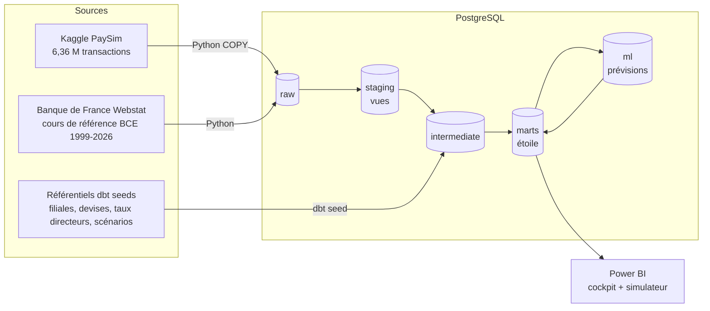
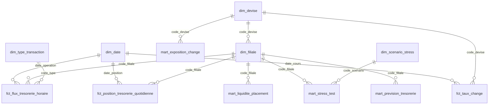

# Projet Crésus — BI prédictive pour la trésorerie de ZF Banque

> **Problématique** : *« Comment l'analyse prédictive et la simulation peuvent-elles être des facteurs de gains dans la gestion de trésorerie d'une banque ? »*
> Étude de cas IBI — Sujet 3 (BI prédictive Finance).

Ce dépôt contient le **POC complet** : une chaîne de données de bout en bout, de la donnée brute jusqu'au cockpit Power BI de la Direction Financière.

| Brique | Outil | Rôle |
|---|---|---|
| Extraction + chargement | **Python** (pandas, psycopg) | Récupère PaySim (Kaggle) et les taux BCE (Banque de France Webstat), les charge dans PostgreSQL |
| Entrepôt de données | **PostgreSQL 16** | Stocke les couches `raw` → `staging` → `intermediate` → `marts` (+ `ml`) |
| Transformation + qualité | **dbt** | Règles de gestion en SQL, modèle en étoile, 71 tests automatiques, documentation et lignage |
| Analyse prédictive | **Python** (statsmodels, numpy) | Prévision des flux (champion/challenger) + simulation Monte-Carlo, fourchettes de change |
| Restitution | **Power BI** | Cockpit, prévisions, risque de change, simulateur de stress test (What-if) |

---

## 1. Architecture



Approche **ELT** : on charge d'abord la donnée brute telle quelle (`raw`), puis toutes les transformations sont écrites en SQL versionné dans dbt. Chaque règle de gestion est tracée (`RG-xxx` dans les modèles) et testée.

---

## 2. Démarrage rapide

### Prérequis
- Python 3.10+ ; Docker Desktop (ou PostgreSQL 15/16 installé) ; Power BI Desktop (Windows).
- Un compte Kaggle (gratuit) **ou** le CSV PaySim téléchargé à la main.

### Installation (PowerShell, Windows)
```powershell
git clone <url-du-depot> ; cd claude-cloud
python -m venv .venv ; .\.venv\Scripts\Activate.ps1
pip install -r requirements.txt
copy .env.example .env          # puis éditer si besoin (identifiants Kaggle, PostgreSQL)
docker compose up -d            # lance PostgreSQL sur localhost:5432 (base "cresus")
```
*(macOS / Linux : `source .venv/bin/activate` et `cp .env.example .env`.)*

### Données PaySim
- **Automatique** : renseigner `KAGGLE_USERNAME` / `KAGGLE_KEY` dans `.env` (jeton créé sur kaggle.com → *Settings* → *Create New Token*).
- **Manuel** : télécharger https://www.kaggle.com/datasets/ealaxi/paysim1, dézipper, déposer `PS_20174392719_1491204439457_log.csv` dans `data/raw/`.

Les taux de change n'ont rien à télécharger : l'export Webstat est versionné dans `data/sources/`.

### Lancement
```powershell
python pipeline.py              # chaîne complète sur les vraies données (~3-5 min)
python pipeline.py --demo       # test rapide : transactions synthétiques, vrais taux de change
python pipeline.py --etapes dbt prevision dbt_prev   # relancer seulement certaines étapes
```

Puis :
```powershell
cd dbt ; dbt docs generate --profiles-dir . ; dbt docs serve --profiles-dir .   # lignage + dictionnaire (idéal en soutenance)
```
Et ouvrir Power BI en suivant [docs/04_guide_power_bi.md](docs/04_guide_power_bi.md).

---

## 3. La démarche pas à pas

Nous avons suivi la consigne du cours : **trouver et valider les sources de données avant de définir les KPI**, puis dérouler les 4 phases AMOA → MOE → POC → soutenance.

### Étape 1 — Cadrage AMOA : traduire le besoin en questions de pilotage
Le sujet fixe 4 objectifs au projet Crésus. Nous les avons reformulés en questions auxquelles le cockpit doit répondre :

| Objectif du sujet | Question de pilotage | Où on y répond |
|---|---|---|
| Anticiper les entrées/sorties de cash par devise | *Quelle sera ma position dans 7 jours, et avec quelle incertitude ?* | `mart_prevision_tresorerie` |
| Stratégie de couverture selon des scénarios de change | *Combien je risque de perdre sur mes devises ? Combien coûte la couverture ?* | `mart_exposition_change`, `mart_prevision_change` |
| Optimiser refinancement et placement | *Ai-je de la liquidité qui dort ? Ai-je un besoin à refinancer ?* | `mart_liquidite_placement` |
| Scénarios de stress sur données réelles | *Combien de jours tient chaque filiale en cas de panique bancaire ?* | `mart_stress_test` + simulateur Power BI |

→ Détail : [docs/01_cadrage_amoa.md](docs/01_cadrage_amoa.md)

### Étape 2 — Sourcing : des données réelles et exploitables
- **Données internes (proxy)** : ZF Banque est fictive, il faut donc un proxy réaliste. **PaySim** (6,36 M de transactions, 743 heures) simule les logs d'un opérateur de paiement mobile : dépôts (`CASH_IN`), retraits (`CASH_OUT`), paiements, virements. C'est exactement la matière première d'une trésorerie de banque de détail.
- **Données externes** : les **cours de référence BCE** exportés de **Banque de France Webstat** (30 devises, 1999 → 23/09/2026). On en garde 7 : USD, CAD (Amérique du Nord), SEK, DKK, NOK (Europe du Nord), JPY et RUB (devises citées par le sujet, en surveillance).
- **Référentiels** que nous avons construits (fichiers CSV dans `dbt/seeds/`) : filiales, devises, taux directeurs des banques centrales (sources officielles indiquées ligne par ligne), scénarios de stress (chacun adossé à une crise historique).

Deux constats « qualité de données » faits dès cette étape, et exploités ensuite :
1. **Le rouble n'est plus coté par la BCE depuis le 01/03/2022** : rupture de série détectée automatiquement par un test dbt (avertissement non bloquant), la devise est exclue des prévisions.
2. **Les francs CFA (XOF pour la Côte d'Ivoire, XAF pour le Cameroun) ne sont pas cotés** : ils ont une parité fixe de 655,957 pour 1 €. Leur risque n'est pas la volatilité mais la **dévaluation** (cas réel : -50 % en janvier 1994), qu'on traite par un scénario de stress.

### Étape 3 — Modélisation des filiales : distribuer toutes les transactions
Le sujet décrit **une dizaine de filiales** en France, Europe du Nord, Afrique et Amérique du Nord. Le référentiel `ref_filiales.csv` en définit 10 :

| Filiale | Devise | Poids clientèle | | Filiale | Devise | Poids clientèle |
|---|---|---|---|---|---|---|
| France | EUR | 30 % | | Côte d'Ivoire | XOF | 10 % |
| Benelux | EUR | 8 % | | Cameroun | XAF | 8 % |
| Finlande | EUR | 4 % | | Canada | CAD | 10 % |
| Suède | SEK | 6 % | | États-Unis | USD | 16 % |
| Danemark | DKK | 4 % | | | | |
| Norvège | NOK | 4 % | | | | |

**Toutes** les transactions PaySim sont réparties entre ces filiales par une règle déterministe (RG-AFF-01) : on calcule un hachage de l'identifiant client, qui le place dans un « seau » de 0 à 9 999. Chaque filiale reçoit une plage de seaux proportionnelle à son poids. Un même client tombe donc toujours dans la même filiale, et la répartition obtenue est exactement celle voulue (contrôlé : 29,9 % des mouvements pour la France, 16,0 % pour les États-Unis…). Pour changer la répartition, il suffit de modifier les poids dans le CSV.

Les virements (`TRANSFER`) restent dans la même filiale dans 85 % des cas ; sinon ils partent vers une autre filiale et deviennent des **flux intragroupe multidevises** (une jambe sortante, une jambe entrante convertie au cours du jour). Un test dbt vérifie que ces flux s'équilibrent à zéro chaque jour au niveau groupe.

### Étape 4 — Ingénierie des données (ELT avec Python, PostgreSQL et dbt)
1. **Extract / Load (Python)** : `COPY` PostgreSQL en flux : 6,4 M de lignes chargées en ~20 s.
2. **Staging (dbt, vues)** : renommage en français, typage, conversion du `step` PaySim (1 h) en date réelle (période rejouée : 01/09/2025 → 01/10/2025, paramétrable).
3. **Intermediate (dbt)** : les règles métier :
   - grille de change quotidienne (week-ends = dernier cours connu, au plus 7 jours ; parités CFA ; EUR = 1) ;
   - affectation aux filiales, sens de trésorerie (+ dépôt / − retrait, paiement, débit), neutralisation des virements internes à une filiale ;
   - valorisation en devise locale puis en EUR au **cours BCE du jour** ;
   - position de départ : encours de dépôts (soldes d'ouverture des clients) × taux de réserve de la filiale.
4. **Marts (dbt, tables)** : modèle en étoile prêt pour Power BI (§ 4 ci-dessous).
5. **Qualité** : 71 tests (unicité, non-nullité, intégrité référentielle, bornes, conservation des volumes, équilibre intragroupe, disponibilité des taux, rupture de série).

→ Détail des règles de gestion et du dictionnaire : [docs/02_specifications_moe.md](docs/02_specifications_moe.md)

### Étape 5 — Définition et calcul des KPI
| KPI | Définition | Usage |
|---|---|---|
| Solde net quotidien par devise | Encaissements − décaissements | Suivi opérationnel |
| Position de trésorerie | Réserve initiale + cumul des flux nets, réévaluée au cours du jour | Pilotage de la liquidité |
| Effet de change | Position au cours du jour − position au cours du 1er jour | Impact du change sur le résultat |
| Exposition au change + **VaR 95 % 10 j** | 1,645 × volatilité × exposition × √10 | Dimensionner la couverture |
| Ratio de couverture de liquidité (LCR simplifié) | Position / (10 % des dépôts + sorties nettes à 30 j) | Conformité Bâle III |
| Liquidité excédentaire → **gain de placement** | max(position − besoin, 0) × taux directeur local | Transformer la trésorerie en centre de profit |
| Besoin de refinancement → **coût** | max(besoin − position, 0) × (taux + marge) | Arbitrage refinancement |
| Coût de couverture de change | Exposition × (taux local − taux BCE) | Arbitrer couvrir / ne pas couvrir |
| Horizon de survie sous stress | Position stressée / sortie nette quotidienne stressée | Stress tests |

### Étape 6 — Analyse prédictive et simulation
- **Flux** : deux modèles sont mis en concurrence pour chaque filiale (*naïf saisonnier* vs *Holt-Winters à saisonnalité journalière multiplicative*). Chacun est **backtesté** sur les 3 derniers jours, et le plus précis (WAPE) devient le **champion**. Sur 6,4 M de transactions, l'erreur du champion est d'environ 2 à 12 %.
- **Simulation Monte-Carlo** : 500 trajectoires futures construites en rejouant des journées réellement observées, mises à l'échelle du niveau prévu → cône P5 / P50 / P95 de la position à J+7 et **probabilité de passer sous le besoin de liquidité**.
- **Change** : fourchette à 30 jours par mouvement brownien géométrique calibré sur la volatilité réelle. Vérification a posteriori sur les vrais cours d'octobre 2025 : le cours réalisé est resté dans la fourchette à 90 % pour USD, CAD, SEK, NOK et DKK, et 82 % des jours pour le JPY.
- **Stress tests** : 7 scénarios précalculés (Northern Rock, SVB, dévaluation du CFA de 1994…) + simulateur dynamique dans Power BI.

Ce que nous avons appris en route (à raconter en soutenance) : notre premier modèle (Holt-Winters sur le logarithme des montants) **sous-estimait les flux de 70 à 99 %** ; la version additive divergeait (+1 500 %) quand l'activité de PaySim chute après la 400ᵉ heure. C'est le backtest qui l'a révélé, d'où le choix d'une démarche champion/challenger : **on ne met jamais un modèle en production sans l'avoir comparé à une référence naïve.**

→ Détail : [docs/03_analyse_predictive_et_simulation.md](docs/03_analyse_predictive_et_simulation.md)

### Étape 7 — Restitution Power BI
Cinq pages : Cockpit DAF · Flux · Prévisions · Change & couverture · Simulateur de stress. Les mesures DAX sont prêtes à coller ([powerbi/mesures_dax.dax](powerbi/mesures_dax.dax)), ainsi qu'un thème ([powerbi/theme_cresus.json](powerbi/theme_cresus.json)).
→ Guide de construction pas à pas : [docs/04_guide_power_bi.md](docs/04_guide_power_bi.md)

### Étape 8 — Synthèse, SWOT et recommandations
→ [docs/05_synthese_swot_recommandations.md](docs/05_synthese_swot_recommandations.md)

---

## 4. Modèle en étoile (schéma `marts`)



## 5. Structure du dépôt

```
├── pipeline.py                 orchestrateur (extract → load → dbt → prévision → dbt)
├── etl/                        code Python
│   ├── extraction_paysim.py    téléchargement Kaggle / détection du CSV local
│   ├── extraction_bce.py       lecture de l'export Webstat (ou fichier BCE)
│   ├── chargement_raw.py       COPY dans PostgreSQL
│   ├── prevision.py            champion/challenger, Monte-Carlo, change
│   ├── donnees_demo.py         transactions synthétiques au format PaySim (tests)
│   └── sql/create_raw.sql      tables brutes
├── dbt/
│   ├── seeds/                  référentiels (filiales, devises, taux directeurs, scénarios)
│   ├── models/staging/         nettoyage technique
│   ├── models/intermediate/    règles de gestion
│   ├── models/marts/           dimensions, faits, analyses, prévisions
│   ├── tests/                  tests métier
│   └── macros/                 hachage, conversion d'horodatage, tests génériques
├── data/sources/               export Webstat (versionné)
├── powerbi/                    mesures DAX + thème
└── docs/                       livrables AMOA / MOE
```

## 6. Hypothèses et limites (à assumer en soutenance)
- PaySim est un **proxy** : volumes et comportements d'un opérateur de paiement mobile, pas d'une vraie banque. La valeur d'une unité PaySim (0,01 €), la répartition entre filiales et les taux de réserve sont des **hypothèses paramétrables**, pas des données de ZF Banque.
- 743 heures d'historique (31 jours) : suffisant pour un profil journalier, insuffisant pour des saisonnalités hebdomadaires ou mensuelles (fins de mois, paie). En production, il faudrait au moins 2 ans d'historique.
- Le LCR est simplifié (un seul taux de fuite de 10 %, pas de pondération des actifs liquides HQLA).
- Les taux directeurs 2025 marqués `a_verifier = true` dans `ref_taux_directeurs.csv` sont à confirmer sur les sites des banques centrales avant la soutenance.
- La prévision de position du groupe = somme des quantiles des filiales : c'est une borne **prudente** (corrélation parfaite supposée).
