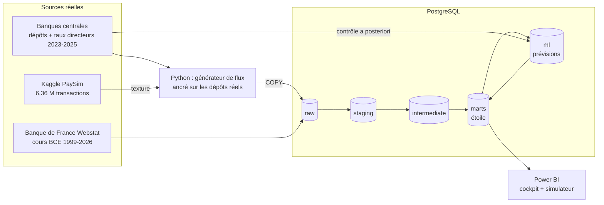
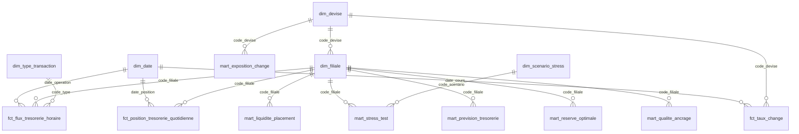

# Projet Crésus — BI prédictive pour la trésorerie de ZF Banque

> **Problématique** : *« Comment l'analyse prédictive et la simulation peuvent-elles être des facteurs de gains dans la gestion de trésorerie d'une banque ? »*
> Étude de cas IBI — Sujet 3 (BI prédictive Finance).

Ce dépôt contient le **POC complet** : une chaîne de données de bout en bout, des sources officielles jusqu'au cockpit Power BI de la Direction Financière, sur **3 ans (2023-2025) et 10 filiales**.

| Brique | Outil | Rôle |
|---|---|---|
| Collecte | **Python** (pandas, requests) | Dépôts et taux directeurs réels des banques centrales (BCE, Fed, Banque du Canada, Riksbank, Norges Bank, Danmarks Nationalbank, FMI, BEAC, BCEAO), cours BCE (Webstat), PaySim (Kaggle) |
| Génération des flux | **Python** | 3 ans de flux quotidiens ancrés sur les dépôts réels, avec la « texture » des vraies transactions PaySim |
| Entrepôt de données | **PostgreSQL 16** | Couches `raw` → `staging` → `intermediate` → `marts` (+ `ml`) |
| Transformation + qualité | **dbt** | Règles de gestion en SQL, modèle en étoile, 95 tests (dont l'ancrage sur les dépôts réels), lignage |
| Analyse prédictive | **Python** (statsmodels, numpy) | Champion/challenger au pas quotidien, simulation Monte-Carlo, réserve optimale, contrôle sur des données réelles postérieures |
| Restitution | **Power BI** | Projet `.pbip` prêt à ouvrir : 6 pages, 65 mesures DAX, simulateur What-if |

---

## 1. Architecture



---

## 2. Démarrage rapide

### Prérequis
- Python 3.10+ ; Docker Desktop (ou PostgreSQL 15/16) ; Power BI Desktop (Windows).
- Un compte Kaggle (gratuit) **ou** le CSV PaySim téléchargé à la main.

### Installation (PowerShell, Windows)
```powershell
git clone <url-du-depot> ; cd claude-cloud
python -m venv .venv ; .\.venv\Scripts\Activate.ps1
pip install -r requirements.txt
copy .env.example .env          # puis éditer si besoin (identifiants Kaggle, PostgreSQL)
docker compose up -d            # lance PostgreSQL sur localhost:5432 (base "cresus")
```
*(macOS / Linux : `source .venv/bin/activate` et `cp .env.example .env`.)*

### Données
- **PaySim** :
  - **automatique** : renseigner `KAGGLE_USERNAME` / `KAGGLE_KEY` dans `.env` ;
  - **manuel** : déposer `PS_20174392719_1491204439457_log.csv` (https://www.kaggle.com/datasets/ealaxi/paysim1) dans `data/raw/`.
- **Séries des banques centrales et cours BCE** : déjà en cache dans `data/sources/` (versionnés), rien à télécharger. Pour les rafraîchir : `python -m etl.sources_reelles`.

### Lancement
```powershell
python pipeline.py              # chaîne complète (~3 min)
python pipeline.py --etapes dbt prevision dbt_prev   # relancer certaines étapes
```
Puis ouvrir **`powerbi/Cresus/Cresus.pbip`** dans Power BI Desktop → *Actualiser* (identifiants PostgreSQL `postgres` / `postgres`). Détails : [docs/04_guide_power_bi.md](docs/04_guide_power_bi.md).

Lignage et dictionnaire de données (idéal en soutenance) : `cd dbt ; dbt docs generate --profiles-dir . ; dbt docs serve --profiles-dir .`

---

## 3. La démarche pas à pas

### Étape 1 — Cadrage AMOA
Les 4 objectifs du sujet sont traduits en questions de pilotage : *quelle sera ma position le mois prochain ? combien je risque sur le change ? où dort de la liquidité, où faut-il se refinancer ? combien de temps tient-on en cas de crise ?* → [docs/01_cadrage_amoa.md](docs/01_cadrage_amoa.md)

### Étape 2 — Sourcing, puis profilage des données
1. **Premier choix** : PaySim (Kaggle) comme proxy des transactions d'une banque de détail, et les cours BCE (Webstat).
2. **Profilage du vrai PaySim** (skill `data:explore-data`). Il révèle des limites rédhibitoires :
   - seuls 12 jours sur 31 ont une activité normale ;
   - la fraude est injectée à rythme constant ;
   - les soldes sont incohérents ;
   - il n'y a pas de flux entrants interbancaires.
   → [docs/06](docs/06_profil_donnees_et_choix_kpi.md)
3. **Décision** : construire **3 ans de données fiables** à partir de **séries réelles publiées par les banques centrales** (dépôts, taux directeurs), en ne gardant de PaySim que la texture des opérations. → [docs/07_donnees_3_ans.md](docs/07_donnees_3_ans.md)

Points d'attention métier relevés au passage :
- le **rouble** n'est plus coté par la BCE depuis le 01/03/2022 (rupture détectée par un test) ;
- les **francs CFA** (XOF pour la Côte d'Ivoire, XAF pour le Cameroun) ont une parité fixe : leur risque est une **dévaluation** (−50 % en 1994), pas la volatilité.

### Étape 3 — Dix filiales ancrées sur la réalité de leur pays
| Filiale | Devise | Dépôts à vue réels utilisés | Part de marché (hypothèse) |
|---|---|---|---|
| France / Benelux / Finlande | EUR | BCE | 1 % / 2 % / 2 % |
| Suède / Danemark / Norvège | SEK / DKK / NOK | SCB / Danmarks Nationalbank / FMI | 1 % chacune |
| Côte d'Ivoire / Cameroun | XOF / XAF | FMI / BEAC | 8 % chacune |
| Canada / États-Unis | CAD / USD | Banque du Canada / Fed (hebdo) | 0,2 % / 0,03 % |

Les flux quotidiens cumulés retombent **exactement** sur les dépôts réels à chaque date publiée : 491 points de contrôle, écart maximal de 0,000007 %, vérifié par un test dbt.

### Étape 4 — Ingénierie des données (ELT : Python → PostgreSQL → dbt)
1. **Collecte** des séries officielles, mises en cache dans `data/sources/`.
2. **Génération** de 2,8 M de lignes, chacune représentant 100 opérations (279 M d'opérations au total).
3. **Chargement** dans PostgreSQL par `COPY`.
4. **Transformation dbt** :
   - valorisation au cours BCE du jour ;
   - position de trésorerie **gérée** : la réserve est ramenée à sa cible chaque mois, par refinancement ou placement ;
   - modèle en étoile.
5. **Qualité** : 95 tests, dont l'ancrage sur les dépôts réels, la complétude, la disponibilité des taux et la fraîcheur des cours.

→ [docs/02_specifications_moe.md](docs/02_specifications_moe.md)

### Étape 5 — Choix des KPI à partir des données
Chaque KPI a été **testé statistiquement**. On n'a gardé que ceux qui varient, sont mesurés, résistent aux artefacts et éclairent une décision. → [docs/06](docs/06_profil_donnees_et_choix_kpi.md)

| KPI retenu | Décision éclairée |
|---|---|
| Position de trésorerie, solde net, encaissements et décaissements | Pilotage quotidien |
| **Ratio de liquidité** (Bâle III simplifié : position / 10 % des dépôts) et **jours sous 100 %** | Conformité ; janvier concentre 40 % des jours sous 100 % |
| **Opérations de trésorerie** : refinancement levé / excédent placé | Combien emprunter ou placer chaque mois |
| **Réserve requise à 99 %** (prévision) vs réserve actuelle | Où libérer de la liquidité, où en lever |
| Prévision P5 / P50 / P95 et probabilité de passer sous 100 % | Anticipation |
| Exposition, **VaR 95 % 10 j**, **effet de change** (−57 M€ sur l'USD en 3 ans) | Risque de change |
| **Rapport coût / risque de la couverture** et recommandation par devise | Quelles devises couvrir |
| Horizon de survie sous stress | Résilience (7 scénarios historiques + simulateur) |
| Part des gros décaissements | Pré-notification des gros retraits |

KPI **écartés après analyse** :
- l'ancien ratio de liquidité (double comptage) ;
- le taux de netting (simple reflet d'une hypothèse) ;
- le taux de fraude dans le temps (artefact) ;
- le pic intrajournalier (redondant).

### Étape 6 — Analyse prédictive et simulation
- **Trois modèles en concurrence** au pas quotidien : naïf hebdomadaire, Holt-Winters, régression calendaire. Cette dernière utilise les jours ouvrés et fériés, le début et la fin de mois, et le **mois de l'année** ; elle gagne sur 19 séries sur 20. Erreur journalière (WAPE) : 12 à 16 % sur les décaissements, 12 à 23 % sur les encaissements, contre 46 % pour le naïf sur les encaissements.
- **Monte-Carlo** : 1 000 trajectoires pour janvier 2026 (erreurs du backtest rééchantillonnées par blocs, plus un choc mensuel).
- **Contrôle sur données réelles postérieures** : les dépôts de janvier 2026, publiés après la date d'arrêté, tombent dans la fourchette à 90 % pour 7 filiales sur 9 (erreur médiane de −3,7 % à +2,0 %). La fourchette de change contient le cours réel 94 % des jours.
- **Ce que le contrôle a appris** : la première version ignorait la **baisse saisonnière des dépôts en janvier** (−3,4 % en France en moyenne), d'où une fourchette trop étroite (4 filiales sur 9). Ajouter l'effet « mois » et un choc mensuel l'a corrigée.

→ [docs/03_analyse_predictive_et_simulation.md](docs/03_analyse_predictive_et_simulation.md)

### Étape 7 — Restitution Power BI
`powerbi/Cresus/Cresus.pbip`, prêt à ouvrir, compte 6 pages : Cockpit DAF · Flux · Prévisions · Change & couverture · Simulateur de stress · Qualité des données.
- Le modèle est validé et converti par la bibliothèque officielle Microsoft (TOM).
- Les 67 fichiers du rapport respectent les schémas JSON Microsoft.

→ [docs/04_guide_power_bi.md](docs/04_guide_power_bi.md)

### Étape 8 — Synthèse, SWOT et recommandations
→ [docs/05_synthese_swot_recommandations.md](docs/05_synthese_swot_recommandations.md)

---

## 4. Modèle en étoile (schéma `marts`)



## 5. Structure du dépôt

```
├── pipeline.py                 orchestrateur (extract → générer → load → dbt → prévision → dbt)
├── etl/
│   ├── sources_reelles.py      dépôts et taux directeurs réels (API des banques centrales)
│   ├── generateur_flux.py      flux 2023-2025 ancrés sur les dépôts réels
│   ├── prevision.py            champion/challenger, Monte-Carlo, réserve optimale, change
│   ├── controle_a_posteriori.py prévision vs dépôts réels publiés ensuite (janvier 2026)
│   ├── extraction_paysim.py / extraction_bce.py / chargement_raw.py
│   └── donnees_demo.py         transactions synthétiques au format PaySim (tests hors Kaggle)
├── data/sources/               séries réelles en cache (versionnées)
├── dbt/                        seeds (référentiels), staging, intermediate, marts, tests, macros
├── powerbi/Cresus/             projet Power BI prêt à ouvrir (Cresus.pbip)
├── powerbi/                    générateur du projet, mesures DAX, thème, outil .NET TomTool
└── docs/                       livrables AMOA / MOE (01 à 07)
```

## 6. Hypothèses et limites (à assumer en soutenance)
- **Les transactions individuelles sont simulées** : aucune banque ne publie les siennes. Sont réels : les niveaux de dépôts (mensuels, hebdomadaires aux États-Unis), les taux directeurs, le change et les jours fériés.
- **Le profil à l'intérieur du mois et les parts de marché sont des hypothèses documentées.** La précision journalière du modèle en découle en partie ; le contrôle sur janvier 2026 réel, lui, n'en dépend pas.
- **Le LCR est simplifié** : un seul taux de fuite de 10 %, pas de pondération des actifs liquides.
- **Cameroun** : 10 mois interpolés. **BCEAO** : le taux de décembre 2022 est déduit (marqué `a_verifier`).
- **Prévision du groupe** : c'est la somme des quantiles des filiales, une borne prudente.
